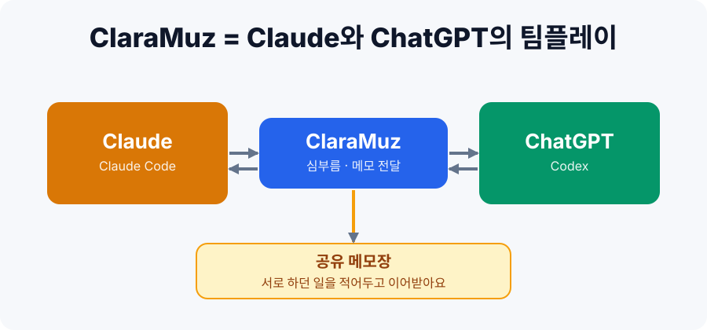
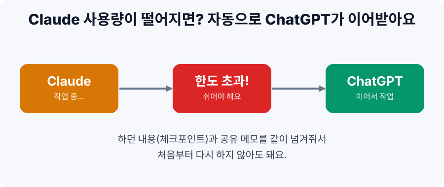
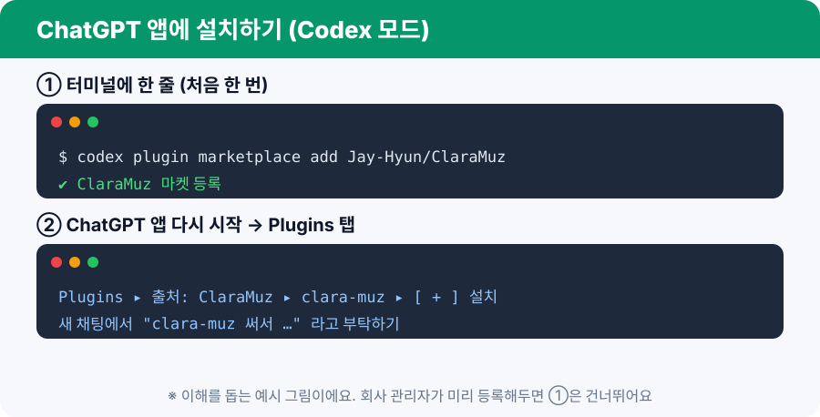
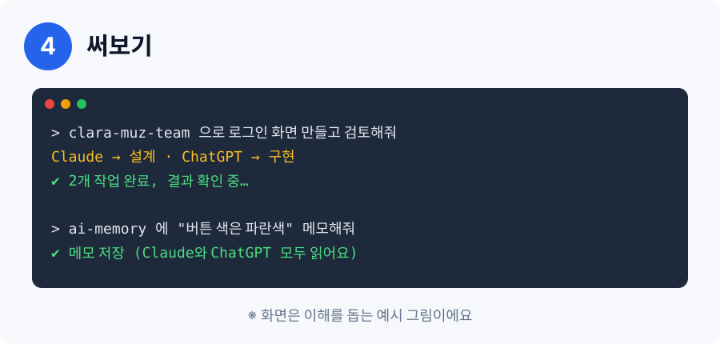

# ClaraMuz 🤝

### Claude와 ChatGPT가 한 팀처럼 일하게 해주는 플러그인



> English summary is at the bottom. ⬇️

## 한 줄 요약

**일을 둘이 나눠 하고, 하던 일은 메모로 넘겨요.** Claude 앱이든 ChatGPT 앱이든 한 번 설치하면 됩니다.

## 이럴 때 써요

| 상황 | ClaraMuz가 해주는 일 |
|---|---|
| "만드는 건 ChatGPT, 검토는 Claude가 했으면…" | 일을 쪼개서 두 AI에게 나눠 맡기고, 결과를 **직접 열어보며 확인**해서 알려줘요 |
| "Claude 사용량이 다 떨어졌어요!" | 지금까지 한 일을 **인수인계 메모**로 정리해줘요. ChatGPT에서 이어서 하면 돼요  |
| "아까 정한 규칙을 또 설명하기 싫어요" | 두 AI가 같이 보는 **공유 메모장**에 적어두면 둘 다 읽어요 |

## 어떻게 동작해요?

- 설치하는 건 **설명서(스킬) 두 개**예요. 프로그램이 아니라서 가볍고, 따로 깔 도구(Node.js 등)가 없어요.
- 공유 메모장은 내 컴퓨터의 평범한 문서 파일이에요 (`~/.clara-muz/memory/`). 메모장으로 열어 고칠 수 있어요.
- 일을 나눌 때는 상대 AI의 명령 도구(`codex` 또는 `claude`)를 불러 써요. 없으면 **AI가 "설치해도 될까요?"라고 먼저 물어봐요.**

| 스킬 | 이럴 때 말하세요 |
|---|---|
| `clara-muz-team` | "둘이 같이 해줘", "다른 AI한테도 검토시켜줘", "구현은 GPT가, 검토는 Claude가" |
| `ai-memory` | "메모해줘", "공유 메모 보여줘", "인수인계 문서 만들어줘" |

## 설치하기

### 0. 앱 준비 (이미 있으면 건너뛰세요)


Claude 데스크톱 앱과 ChatGPT 데스크톱 앱(Codex 포함) 중 **쓰는 쪽을 설치하고 로그인**해요. 둘 다 있으면 서로 일을 나눌 수 있어요.

### 길 A. Claude 앱에 설치 (Code 탭)


Claude 앱의 **Code 탭** 입력창에 한 줄씩 붙여넣고 Enter:

```
/plugin marketplace add Jay-Hyun/ClaraMuz
/plugin install clara-muz@clara-muz
```

### 길 B. ChatGPT 앱에 설치 (Codex 모드)



1. 터미널(Mac은 "터미널", Windows는 "PowerShell")에 한 줄 붙여넣기:
   ```
   codex plugin marketplace add Jay-Hyun/ClaraMuz
   ```
2. ChatGPT 앱을 **다시 시작**해요.
3. **Plugins 탭**에서 출처 `ClaraMuz`를 고르고 `clara-muz`의 **＋** 를 눌러 설치해요.
4. **새 채팅**을 열어서 쓰세요.

> **회사 관리자라면:** ChatGPT 워크스페이스의 **Admin → Plugins**에서 이 GitHub 저장소(`Jay-Hyun/ClaraMuz`)를 가져오면, 직원들은 1번을 건너뛰고 Plugins 탭에서 설치만 하면 돼요. (OpenAI 공식 문서 기준이에요.)

### 한쪽만 설치해도 되나요?

ChatGPT 앱에 설치하면 **Chat·Work·Codex**에서 같은 플러그인이 보이고, Claude 앱에 설치하면 **Code 모드**에서 쓸 수 있어요. 단, 두 AI가 **같이 일하려면 명령을 실행할 수 있는 모드**(Claude의 Code 탭, ChatGPT의 Codex)에서 써야 해요. 일반 채팅 화면에서는 "인수인계 글 만들기"만 돼요.

## 써보기



그냥 말로 부탁하면 돼요.

```
clara-muz-team 으로 README를 읽고 오타를 찾아줘
ai-memory 에 "버튼 색은 파란색" 메모해줘
ai-memory 로 인수인계 문서 만들어줘
```

Claude 앱에서는 `/clara-muz:clara-muz-team`, `/clara-muz:ai-memory`처럼 슬래시로도 부를 수 있어요.

- 처음에 AI가 "파일을 읽어도 될까요?", "명령을 실행해도 될까요?"라고 물을 수 있어요. 내용을 보고 허락하면 돼요.
- 상대 AI의 명령 도구가 없으면 "설치해도 될까요?"라고 물어봐요. **"응"** 하면 공식 설치 방법으로 설치해줘요. 그 뒤 해당 앱에 로그인되어 있는지만 확인해주세요.

> 그림 속 화면은 이해를 돕기 위한 **예시 그림**이에요. 실제 화면과 글자가 조금 다를 수 있어요.

## 안전하게 쓰기

- 상대 AI에게 일을 맡길 때 **읽기 전용이 기본**이고, 파일을 고쳐야 할 때만 쓰기 모드를 써요.
- 지금 작업 중인 폴더 밖은 건드리지 않도록 지시해요. (지시일 뿐 강제 차단은 아니에요.)
- 공유 메모장에는 **비밀번호, 키, 개인정보를 적지 마세요.** 평문 파일이에요.
- 메모장 위치: Mac/Linux `~/.clara-muz/memory/`, Windows `C:\Users\내이름\.clara-muz\memory\`

## 자주 묻는 질문

- **돈이 드나요?** ClaraMuz는 무료예요. Claude와 ChatGPT는 각자 쓰던 구독 그대로예요.
- **Node.js나 서버가 필요한가요?** 아니요.
- **한쪽 AI만 있어도 되나요?** 네. 메모장과 인수인계는 되고, 일 나누기는 그 AI의 하위 작업자로 처리해요. 상대 AI가 없었다면 AI가 그렇게 말해줘요.
- **메모는 어떻게 넘어가나요?** 한쪽이 쓴 메모 파일을 다른 쪽이 읽어요. 인수인계 메모는 한 번 가져가면 `claimed`로 바뀌어 중복으로 가져가지 않아요. [ai-memory](https://github.com/akitaonrails/ai-memory)의 아이디어를 가볍게 빌려왔고, 둘은 서로 독립적이에요.
- **메모를 항상 자동으로 읽게 하고 싶어요.** `ai-memory 로 init 해줘`라고 하면 앱의 전역 지침 파일에 한 줄 규칙을 추가해줘요(확인 후).

## 문제가 생기면

| 증상 | 해보세요 |
|---|---|
| 명령어가 안 먹어요 | 앱을 완전히 종료했다가 다시 켜세요 |
| `codex`/`claude`를 찾을 수 없대요 | AI가 설치해준다고 하면 "응"이라고 하거나, 해당 앱의 공식 설치 안내를 따라 설치하세요 |
| "로그인이 필요하다"고 해요 | 해당 앱(Claude 또는 ChatGPT)에 로그인한 뒤 다시 시도하세요 |
| ChatGPT Plugins 탭에 안 보여요 | `codex plugin marketplace list`로 등록됐는지 확인하고 앱을 재시작하세요 |

## 현재 상태 (솔직하게)

v0.6.0. **사내 검증 전 단계**예요.

| 항목 | 상태 |
|---|---|
| Claude가 리더로 `clara-muz-team` 실행 (가짜 Codex로) | ✅ 확인: 메모 읽기, 설치 확인, 읽기 전용 실행, 결과 직접 검증, 가짜임을 알아챔 |
| `ai-memory` 메모 추가·조회 (진짜 Claude) | ✅ 확인 |
| Claude용 플러그인 구조 검사 (`claude plugin validate`) | ✅ 통과 |
| 진짜 Codex 실행, ChatGPT/Codex 앱에서 설치·동작 | ⏳ **미검증** (문서 기준으로 구성) |
| Codex가 리더일 때 Claude 호출 | ⏳ **미검증** |
| Claude 데스크톱 앱 Code 탭에서의 설치 화면 | ⏳ **미검증** |
| Windows | ⏳ **미검증** |

예전 Node 서버(작업 취소, 폴더 강제 제한, MCP 모드)는 고급 사용자용으로 `extras/node-server/`에 남겨뒀어요. 기본 설치에는 들어가지 않아요.

---

## English

**ClaraMuz lets Claude and ChatGPT work as one team**: split a task, verify each other's results, and hand over unfinished work through shared notes. It is two skills (plain instructions), no Node.js, no server, no MCP.

- `clara-muz-team`: lead AI splits the work, runs the other AI (`codex exec` / `claude -p`), and verifies results itself.
- `ai-memory`: shared plain-markdown notes and one-time handoffs in `~/.clara-muz/memory/`, inspired by [ai-memory](https://github.com/akitaonrails/ai-memory).
- If the other AI's command is missing, the lead offers to install it after your confirmation.

Install in **Claude** (Code tab): `/plugin marketplace add Jay-Hyun/ClaraMuz`, then `/plugin install clara-muz@clara-muz`.
Install in **ChatGPT/Codex**: `codex plugin marketplace add Jay-Hyun/ClaraMuz`, restart the app, open the Plugins tab and install. Workspace admins can import the repo under Admin > Plugins.

Layout: `plugins/clara-muz/` holds both manifests (`.claude-plugin/plugin.json`, `plugin.json`) and `skills/`; `.claude-plugin/marketplace.json` and `.agents/plugins/marketplace.json` point to it.

Untested: real Codex runs, the ChatGPT/Codex install flow, Codex-as-lead, desktop app install UIs, Windows.

## License

MIT
