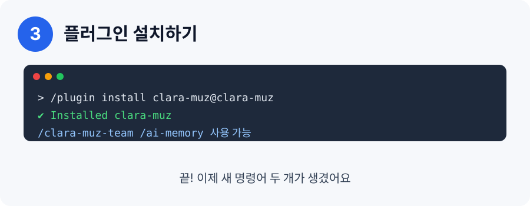

# ClaraMuz 🤝

**Claude와 ChatGPT가 서로 일을 나눠 하는 플러그인**이에요.


> English summary is at the bottom. ⬇️

## 이게 뭐예요?

Claude Code 안에서 "이 일은 ChatGPT(Codex)가 해줘", "검토는 Claude가 해줘"처럼 **일을 나눠 맡길 수 있게** 해줘요.
둘이 쓰는 **공유 메모장**도 있어서, 한쪽이 하던 일을 다른 쪽이 이어받을 수 있어요.

- 서버도, MCP도, API 키도 필요 없어요. **내 컴퓨터에 이미 로그인된 `claude`, `codex` 프로그램**을 그대로 불러 써요.
- 그래서 MCP 때문에 생기는 트래픽 제한도 없어요. (모델 사용량 한도는 각자 구독 그대로예요.)

## 어떤 기능이 있어요?

| 기능 | 설명 |
|---|---|
| `/clara-muz-team 할 일` | 할 일을 쪼개서 Claude와 ChatGPT에게 나눠 맡기고, 결과를 확인해서 알려줘요 |
| `/ai-memory` | 둘이 같이 보는 메모장을 보고, 쓰고, 찾고, 지워요 |
| 자동 이어받기 | Claude 사용량이 다 떨어지면 ChatGPT가 이어서 해요  |
| 인수인계 | "여기까지 했고 이건 남았어"를 적어두면 상대가 딱 한 번 가져가요 |
| 안전 장치 | 허락한 폴더 안에서만 일해요. 읽기 전용이 기본이에요 |

## 설치 방법 (4단계)

### 1단계. 준비물 설치 (처음 한 번만)


- **Node.js** (버전 18 이상): <https://nodejs.org> 에서 LTS 버튼을 눌러 설치해요.
- **Claude Code**: 설치하고 로그인해요.
- **Codex CLI** (선택): ChatGPT도 같이 쓰려면 설치하고 로그인해요. 없으면 Claude 쪽 기능만 돼요.

### 2단계. 플러그인 가게 등록


Claude Code 입력창에 이걸 붙여넣고 Enter:

```
/plugin marketplace add Jay-Hyun/ClaraMuz
```

### 3단계. 플러그인 설치



```
/plugin install clara-muz@clara-muz
```

### 4단계. 써보기


```
/clara-muz-team README를 읽고 오타를 찾아줘
/ai-memory add 버튼 색은 파란색으로
```

처음 쓸 때 Claude가 "명령어를 실행해도 될까요?"라고 물어볼 수 있어요. 내용을 확인하고 허락하면 돼요.

> 그림 속 화면은 이해를 돕기 위한 **예시 그림**이에요. 실제 화면과 글자가 조금 다를 수 있어요.

## 작업 폴더 허락하기 (중요)

기본으로는 **Claude Code를 켠 폴더 안에서만** 일해요. 다른 폴더도 쓰고 싶다면:

- macOS / Linux: `export CLARAMUZ_ALLOWED_ROOTS="$HOME/projects:$HOME/work"`
- Windows(PowerShell): `$env:CLARAMUZ_ALLOWED_ROOTS="C:\Users\me\projects"`

## 공유 메모장은 어떻게 생겼나요?

[ai-memory](https://github.com/akitaonrails/ai-memory)처럼 **평범한 마크다운 파일**이에요. (`~/.clara-muz/memory/*.md`)
메모장으로 열어 고치거나, `grep`으로 찾거나, git에 올릴 수 있어요. 비밀번호 같은 건 적지 마세요.
ai-memory는 서버와 훅까지 갖춘 별도의 큰 프로젝트이고, ClaraMuz는 그 아이디어(마크다운 메모, 한 번만 가져가는 인수인계)를 가볍게 빌려왔어요. 둘은 서로 독립적이에요.

## 자주 묻는 질문

- **MCP는 꼭 필요해요?** 아니요. 기본은 MCP 없이 명령어(CLI)로 동작해요. MCP로 쓰고 싶다면 `docs/mcp.example.json` 내용을 MCP 설정에 넣으면 같은 서버가 MCP로도 열려요.
- **돈이 드나요?** ClaraMuz는 무료예요. Claude/ChatGPT는 각자 쓰던 구독 그대로예요.
- **Windows에서 되나요?** 코드는 Windows도 고려했지만 아직 실제로 시험하지 못했어요.
- **Codex 없이도 되나요?** 네. Claude 쪽 기능과 메모장은 돼요.

## 설정값

| 환경변수 | 기본값 | 뜻 |
|---|---|---|
| `CLARAMUZ_ALLOWED_ROOTS` | 현재 폴더 | 작업을 허락하는 폴더들 (`:` 또는 Windows는 `;`로 구분) |
| `CLARAMUZ_HOME` | `~/.clara-muz` | 작업 기록과 메모가 저장되는 곳 |
| `CLARAMUZ_TIMEOUT_SECONDS` | `480` | 작업 하나의 제한 시간 |
| `CLARAMUZ_AUTO_HANDOFF` | 켜짐 | `0`이면 자동 이어받기를 꺼요 |
| `CLARAMUZ_MEMORY_CHARS` | `6000` | 작업마다 넣어주는 메모 최대 글자 수 |

## 현재 상태 (솔직하게)

v0.4.0. 리눅스에서 진짜 Claude CLI로 시험한 것: 일 맡기기, 기다리기, 결과 보기, 이어하기, 취소, 메모 주고받기, 폴더 제한.
**아직 시험 못 한 것**: 진짜 `codex`, Windows, 자동 이어받기(가짜 CLI로만 확인), 플러그인 설치 과정 전체.

---

## English

ClaraMuz is a Claude Code plugin that lets Claude and ChatGPT (Codex CLI) split work and share memory. **No server, no MCP, no API keys**: it launches your already logged-in `claude` and `codex` CLIs as background jobs.

- `/clara-muz-team <task>`: delegate, wait, verify results.
- `/ai-memory`: shared plain-markdown notes and one-time handoffs, inspired by [ai-memory](https://github.com/akitaonrails/ai-memory).
- Automatic Claude to GPT handoff on quota errors.
- Safety: jobs run only inside `CLARAMUZ_ALLOWED_ROOTS`; Claude jobs are read-only by default.

Install: `/plugin marketplace add Jay-Hyun/ClaraMuz`, then `/plugin install clara-muz@clara-muz`. Requires Node 18+ and a logged-in `claude` (and optionally `codex`).

MCP is optional: `docs/mcp.example.json` runs the same `server/index.mjs` as a stdio MCP server for other MCP clients.

Untested: real `codex exec`, Windows, the full plugin install flow.

## License

MIT
