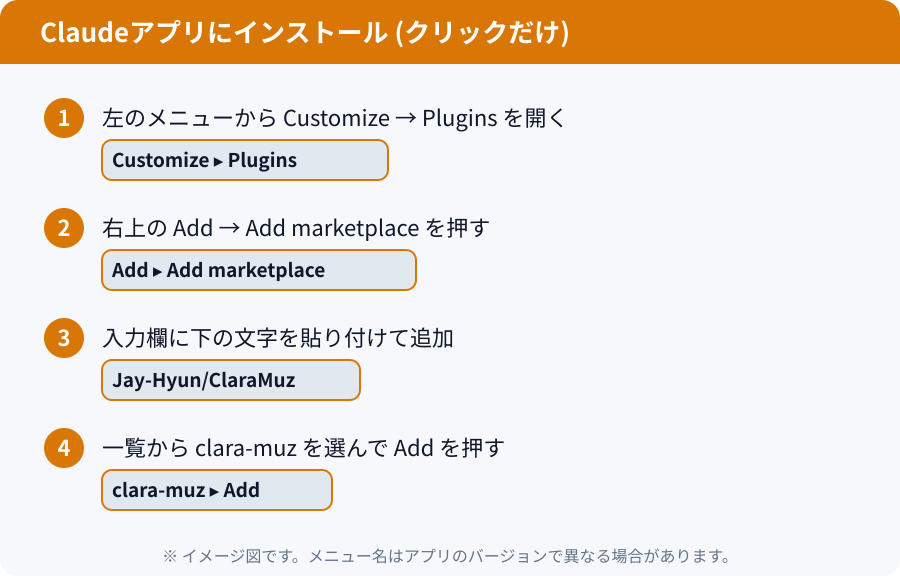
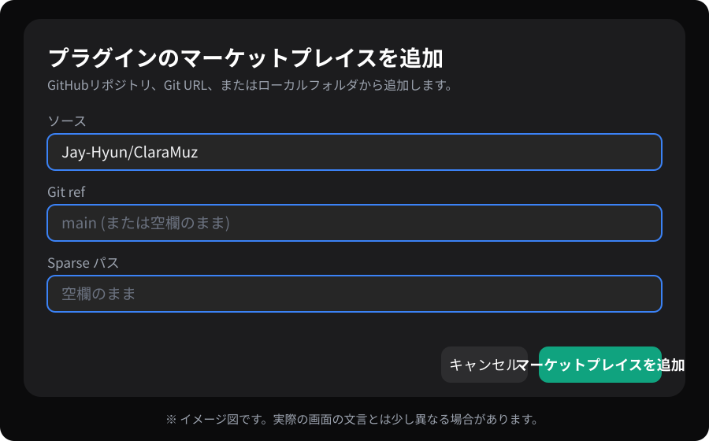
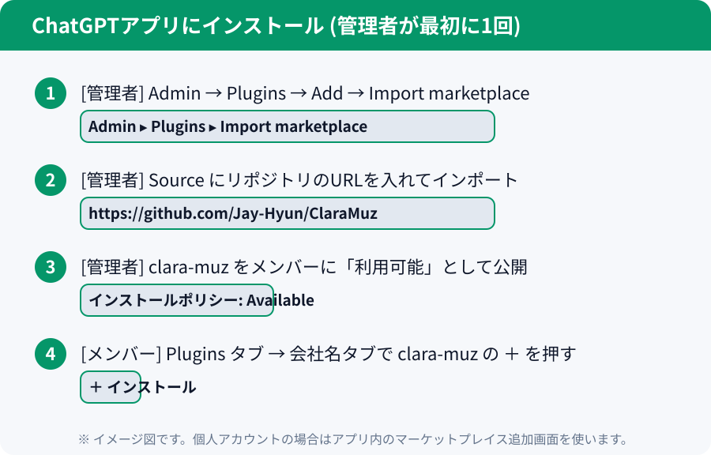

# インストールガイド (アプリ内のクリックだけ)

ターミナルなしで、**アプリ内のクリックだけ**でインストールします。ターミナルを使う方法は[CLIインストールガイド](INSTALL-CLI.ja.md)をご覧ください。

まず**Claudeデスクトップアプリ**または**ChatGPTデスクトップアプリ**をインストールしてログインします。両方あれば、2つのAIで作業を分担できます。

## A. Claudeアプリ

1. アプリで **Customize → Plugins** を開きます。
2. **Add → Add marketplace** を押します。
3. 入力欄に `Jay-Hyun/ClaraMuz` を貼り付けて追加します。
4. 一覧から **clara-muz** を選んで **Add** を押します。

- 1回インストールすれば、同じアカウントのチャット、Cowork、Claude Codeで再インストールなしに使えます。
- **Codeタブ**では、プロンプト横の **＋ → Add plugins** からもインストールできます。

## B. ChatGPTアプリ (個人・会社どちらも)

1. アプリで **Plugins** 画面を開き、**プラグインのマーケットプレイスを追加**を押します。
2. **ソース**欄に `Jay-Hyun/ClaraMuz` を貼り付けます。
3. **Git ref** と **Sparse パス**は**空欄のまま**にします。(Git refを入れる場合は `main`)
4. **マーケットプレイスを追加**を押し、一覧の **clara-muz** で **＋ プラグインをインストール**を押します。
5. **新しいチャット**を開いて使います。プラグインのページにスキルが**2つ**(Ai Memory、Clara Muz Team)表示されれば成功です。

> プラグインのアイコンはClaraMuzのロゴです。オレンジの円と緑の円が重なり、中央に双方向の矢印があります。

### 会社全体に配布する (ワークスペース管理者)

- **管理者:** **Admin → Plugins → Add → Import marketplace** を開き、Sourceに `https://github.com/Jay-Hyun/ClaraMuz` を入力してインポートします。その後、`clara-muz` のインストールポリシーを、配布したいロールに対して **Available**(またはInstalled)にします。
- **メンバー:** **Pluginsタブ → 会社名のタブ**で `clara-muz` の **＋** を押すだけです。上記Bの1〜3は不要です。

## うまくいかないとき

| 症状 | 対処 |
|---|---|
| マーケットプレイスを追加できない | ソースが `Jay-Hyun/ClaraMuz` と正確に入力されているか、Git refとSparse パスが空欄か確認してください |
| ClaudeでAdd marketplaceがブロックされる | 管理者が外部マーケットプレイスをブロックしている可能性があります。管理者に確認してください |
| プラグインが一覧に出ない | アプリを完全に終了して、もう一度起動してください |
| スキルが反応しない | 新しいチャット(新しいセッション)を開いて、もう一度頼んでください |

> メニュー名はアプリのバージョンで異なる場合があります。画像はイメージ図です。
