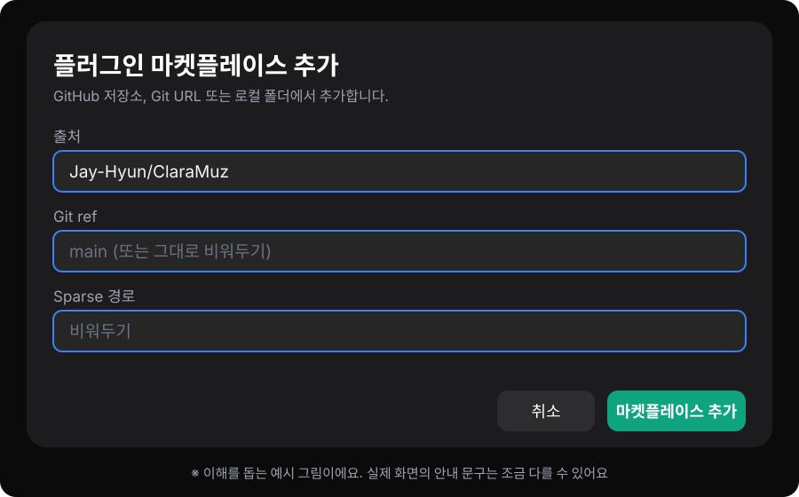
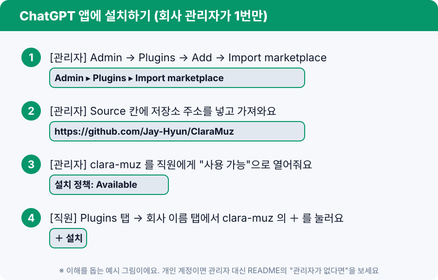

# 설치 가이드 (앱에서 클릭으로)

터미널 없이 **앱 화면에서 클릭만으로** 설치해요. 터미널을 쓰는 방법은 [CLI 설치 가이드](INSTALL-CLI.ko.md)를 보세요.

먼저 **Claude 데스크톱 앱**이나 **ChatGPT 데스크톱 앱** 중 쓰는 쪽을 설치하고 로그인해요. 둘 다 있으면 서로 일을 나눌 수 있어요.

## A. Claude 앱

1. 앱에서 **Customize → Plugins** 를 열어요.
2. **Add → Add marketplace** 를 눌러요.
3. 입력칸에 `Jay-Hyun/ClaraMuz` 를 붙여넣고 추가해요.
4. 목록에서 **clara-muz** 를 골라 **Add** 를 눌러요.

- 한 번 설치하면 같은 계정의 채팅, Cowork, Claude Code에서 다시 설치하지 않고 써요.
- **Code 탭**에서는 프롬프트 옆 **＋ → Add plugins** 로도 설치할 수 있어요.

## B. ChatGPT 앱 (개인·회사 모두)

1. 앱에서 **Plugins** 화면을 열고 **플러그인 마켓플레이스 추가**를 눌러요.
2. **출처** 칸에 `Jay-Hyun/ClaraMuz` 를 붙여넣어요.
3. **Git ref** 와 **Sparse 경로** 는 **비워두세요.** (Git ref를 넣는다면 `main`)
4. **마켓플레이스 추가**를 누르고, 목록에서 **clara-muz** 의 **＋ 플러그인 설치**를 눌러요.
5. **새 채팅**을 열어서 써요. 플러그인 화면에서 스킬이 **2개**(Ai Memory, Clara Muz Team) 보이면 성공이에요.

> 설치 화면의 아이콘은 ClaraMuz 로고(주황 원과 초록 원이 겹치고 양방향 화살표가 있는 모양)예요.

### 회사 관리자가 직원 전체에게 배포하기

- **관리자:** **Admin → Plugins → Add → Import marketplace** 에서 Source에 `https://github.com/Jay-Hyun/ClaraMuz` 를 넣고 가져와요. 그다음 `clara-muz`의 설치 정책을 **Available**(또는 Installed)로 열어줘요.
- **직원:** **Plugins 탭 → 회사 이름 탭**에서 `clara-muz` 의 **＋** 만 누르면 돼요. 직원은 위 B의 1~3번을 안 해도 돼요.

## 잘 안 되면

| 증상 | 해보세요 |
|---|---|
| 마켓플레이스 추가가 안 돼요 | 출처에 `Jay-Hyun/ClaraMuz` 를 정확히 넣었는지, Git ref·Sparse 경로를 비웠는지 확인하세요 |
| Claude에서 Add marketplace가 막혀 있어요 | 회사 관리자가 외부 마켓 추가를 막았을 수 있어요. 관리자에게 문의하세요 |
| 플러그인이 목록에 안 보여요 | 앱을 완전히 종료했다가 다시 켜세요 |
| 스킬을 불러도 반응이 없어요 | 새 채팅(새 세션)을 열어서 다시 말해보세요 |

> 메뉴 이름은 앱 버전에 따라 조금 다를 수 있어요. 그림은 이해를 돕는 예시예요.
