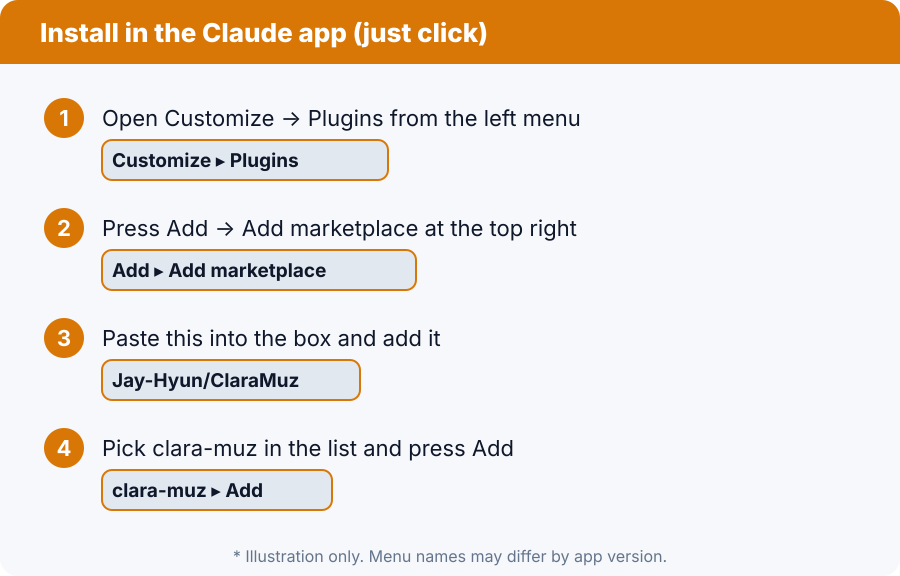
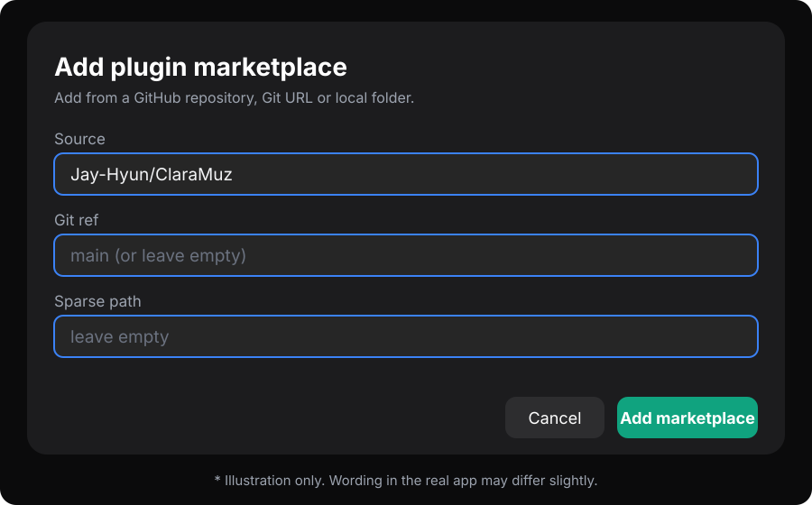
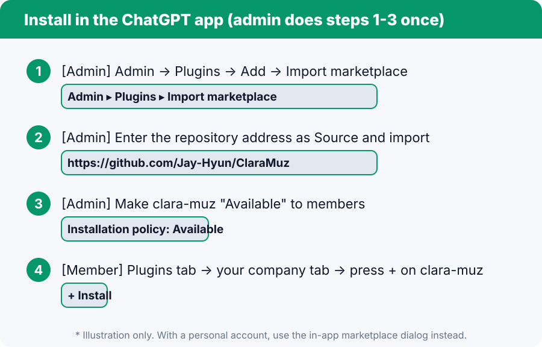

# Install guide (click in the app)

Install by **clicking in the app**, no terminal. For the terminal route, see the [CLI install guide](INSTALL-CLI.md).

First install and sign in to the **Claude desktop app** or the **ChatGPT desktop app**. With both, the two AIs can share work.

## A. Claude app

1. Open **Customize → Plugins** in the app.
2. Press **Add → Add marketplace**.
3. Paste `Jay-Hyun/ClaraMuz` into the box and add it.
4. Pick **clara-muz** in the list and press **Add**.

- Once installed, it is available in chat, Cowork and Claude Code on the same account without installing again.
- In the **Code tab** you can also use **+ next to the prompt box → Add plugins**.

## B. ChatGPT app (personal or company)

1. Open the **Plugins** screen in the app and press **Add plugin marketplace**.
2. Paste `Jay-Hyun/ClaraMuz` into **Source**.
3. Leave **Git ref** and **Sparse path** **empty**. (If you fill Git ref, use `main`.)
4. Press **Add marketplace**, then press **+ Install plugin** on **clara-muz** in the list.
5. Open a **new chat** and use it. If the plugin page shows **2 skills** (Ai Memory, Clara Muz Team), it worked.

> The plugin icon is the ClaraMuz logo: an orange circle and a green circle overlapping, with two-way arrows in the middle.

### Rolling out to the whole company (workspace admin)

- **Admin:** open **Admin → Plugins → Add → Import marketplace**, enter `https://github.com/Jay-Hyun/ClaraMuz` as Source and import. Then set the installation policy of `clara-muz` to **Available** (or Installed) for the roles that should get it.
- **Members:** on the **Plugins tab → your company tab**, just press **+** on `clara-muz`. They can skip steps 1-3 of B.

## If something goes wrong

| Symptom | Try this |
|---|---|
| Adding the marketplace fails | Check that Source is exactly `Jay-Hyun/ClaraMuz` and that Git ref and Sparse path are empty |
| Claude blocks Add marketplace | Your admin may block external marketplaces. Ask them |
| The plugin is not in the list | Quit the app completely and start it again |
| The skill does not respond | Open a new chat (new session) and ask again |

> Menu names may differ by app version. The pictures are illustrations.
